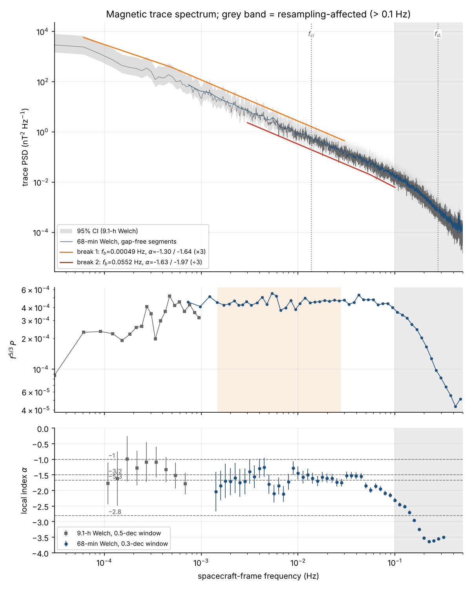
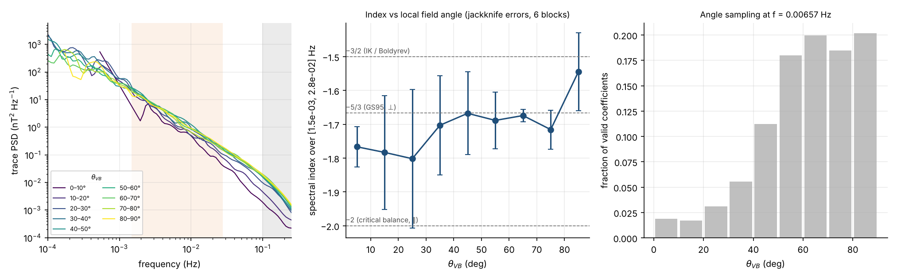
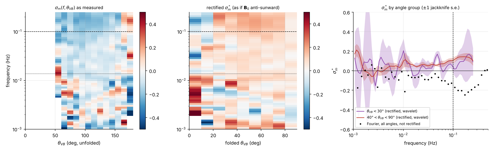
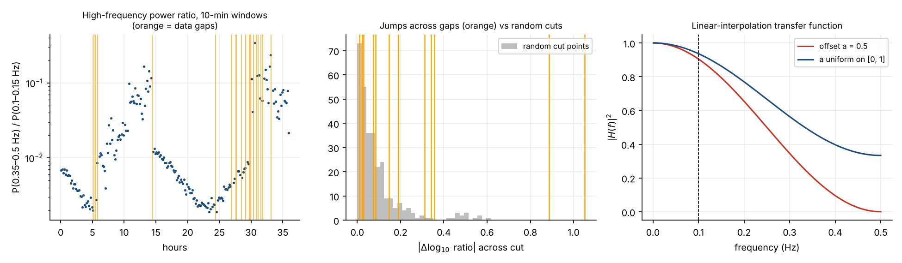

# Power-Spectral-Analysis

Spectral analysis of magnetic-field turbulence in the solar wind. Every result has a stated uncertainty and every method has a reference.

The repository started as a single FFT script. It is now a tested Python package (`psa/`) plus one reproducible pipeline (`scripts/run_analysis.py`). The pipeline is applied to a 36-hour Ulysses interval in the fast solar wind over the Sun's south pole (10–11 April 1994).

```bash
pip install -r requirements.txt
python scripts/run_analysis.py          # ~25 s → results/summary.json, results/RESULTS.md, results/figures/*.png
pytest -q                               # 34 tests on synthetic data with known answers
```

To analyse another AMDA export, run `python scripts/run_analysis.py --data your_file.txt[.gz] --out results_other`.

---

## 1. Headline results (Ulysses, 1994-04-10 00:00 → 04-11 12:00 UT)

| quantity | value |
|---|---|
| Inertial-range index (1.5–28 mHz) | **α = −1.649 ± 0.050** (segment bootstrap; statistical ±0.031, fit-range spread −1.673 to −1.649, 9-h quarters −1.57 to −1.75) |
| Cross-check from structure function S₂ | ζ₂ = 0.652 → α = −1.652 |
| Comparison with theory | Consistent with −5/3 (0.4σ). −3/2 is 3.0σ away with the bootstrap error, or ~2σ if the scatter between quarters is used instead. |
| Low-frequency break (1/f-like → inertial) | f_b = 0.49 mHz (68%: 0.28–1.2 mHz); index below the break −1.30 ± 0.17 |
| Ion-scale steepening | f_b = 0.055 Hz (68%: 0.050–0.060) = 4.0 f_ci = 0.20 f_di; index from f_b to 0.1 Hz −1.97 ± 0.10 (−1.89 ± 0.10 after a resampling correction, §4) |
| Power anisotropy | P(θ_VB < 10°) / P(80–90°) = 0.37 at 6.6 mHz |
| Index vs field angle | −1.77 ± 0.06 (0–10°) vs −1.54 ± 0.12 (80–90°) |
| Reduced magnetic helicity (oblique angles, 40–90°) | σ_m* = +0.048 ± 0.010 (0.02 Hz), +0.057 ± 0.013 (0.05 Hz), +0.10 ± 0.03 (0.1 Hz), +0.14 ± 0.04 (0.2 Hz) |
| Compressibility P_\|B\|/P_trace | 0.044 (inertial median) → 0.073 (0.1 Hz) → 0.12 (0.2 Hz) |
| Alfvénicity at 1–4.3 h periods | σ_c = 0.69, σ_r = −0.54, E⁺/E⁻ = 5.4 |
| Flatness of increments (1-h windows) | 9.5 (1 s), 10.7 (10 s), 3.1 (~10 min) |

Plasma context: ⟨|B|⟩ = 0.90 nT, ⟨n_p⟩ = 0.26 cm⁻³, ⟨V⟩ = 781 km/s, V_A = 38 km/s.
- Taylor's hypothesis is safe: V_A/V = 0.049.
- d_i = 447 km, f_ci = 0.0137 Hz, f_di = V/(2π d_i) = 0.278 Hz.
- δB_rms/⟨|B|⟩ = 0.91, but σ(|B|)/⟨|B|⟩ = 0.18. The fluctuations are large and nearly constant in magnitude.
- ⟨B_R⟩ < 0, so the field points inward (sunward) on average.

The full table is in [`results/RESULTS.md`](results/RESULTS.md) and every number is in [`results/summary.json`](results/summary.json).

### What the results mean (and what they do not)

- **Inertial range.**
  - The magnetic spectrum follows −5/3 over 1.3 decades. The compensated spectrum in Fig. 2 is flat from 2 to 45 mHz.
  - The structure function gives the same index independently.
  - Kolmogorov (1941) −5/3 fits. Iroshnikov–Kraichnan/Boldyrev −3/2 (Iroshnikov 1964; Kraichnan 1965; Boldyrev 2006) is disfavoured, but only at 2–3σ, and only for this interval.
- **1/f break.**
  - The spectrum is shallower below 0.5 mHz. However, 36 h covers less than one decade below the break, so this is *not* a measurement of a 1/f range. The index below the break moves from −1.30 to −1.15 when the lowest frequency bins are dropped.
  - Polar turbulence evolves more slowly with distance than turbulence in low-latitude fast streams (Horbury et al. 1996), so this break at ~3.3 AU is a useful data point for radial-evolution studies.
  - At τ = 1/f_b the normalised increment is δB/⟨|B|⟩ = 0.85, and it reaches 1 at τ ≈ 4500 s. This agrees, within a factor ~2 in scale, with Matteini et al. (2018): the 1/f range is where fluctuations saturate at δB ~ |B|.
- **Ion-scale break.**
  - Steepening starts at 0.055 Hz, between f_ci and f_di.
  - Only 0.26 decades above the break can be used (up to 0.1 Hz, §4). The −1.9 to −2.0 index is therefore the start of the transition, not the sub-ion-scale index.
  - Without a proton temperature there is no β or ρ_i, so we cannot say which scale controls the break (Chen et al. 2014).
- **Anisotropy.**
  - Power across the field exceeds power along it, and the near-parallel index is steeper. Both point the same way as critical balance (Goldreich & Sridhar 1995; Horbury et al. 2008).
  - But the parallel index (−1.77 ± 0.06) is clearly shallower than the −2 that Wicks et al. (2010) found in much longer Ulysses polar datasets.
  - The parallel–perpendicular difference is only 1.7σ, and just 1.9% of wavelet coefficients sample θ_VB < 10°. A 36-h interval cannot settle this.
- **Helicity.**
  - At oblique angles the rectified helicity is positive and grows toward ion scales. It is significant at 4–5σ at 0.02–0.05 Hz.
  - In the outward-sector convention of He et al. (2011) this is right-handed polarisation, the kinetic-Alfvén-wave signature (Howes & Quataert 2010). It is centred at oblique angles, as Podesta & Gary (2011) found in Ulysses polar wind.
  - No consistent left-handed (ion-cyclotron) signal is seen at quasi-parallel angles. For θ_VB < 30°, σ_m* = +0.17 ± 0.03 (0.05 Hz), +0.05 ± 0.05 (0.1 Hz) and +0.16 ± 0.27 (0.2 Hz). Only the narrowest bins (θ_VB < 20°) turn negative at 0.1–0.2 Hz (−0.02 to −0.22), and their errors are 0.13–0.19. These angles hold only ~3.5% of the coefficients.
  - The physical reading assumes the fluctuations propagate away from the Sun. σ_c > 0 supports this at low frequency, but it is not measured at ion scales.
- **Alfvénicity.** Outward-propagating fluctuations dominate by a factor of ~5 in energy, with a magnetic excess (σ_r < 0). This is typical of polar fast wind. Including alpha particles (4% by number) would raise σ_r by about 0.06.

---

## 2. What was wrong with the original script

The original code is kept verbatim in [`legacy/original_script.py`](legacy/original_script.py), and `psa/legacy.py` reproduces it for comparison.

1. **It returns NaN on this file and gives no warning.** The file has 2,396 missing field samples (1.85%), and one NaN turns the whole FFT into NaN. Running the script prints `Slope ... : nan` and draws an empty plot.
2. **It fits B_x only but labels the result "B_AVG".** `PB_AVG` is computed and never used.
3. **The units are not a PSD.** `|X|²/n` is missing the factor 2·dt of a one-sided density in nT²/Hz. The frequency axis `fftfreq(n, 1/n)/n` is right only because dt = 1 s.
4. **The spectrum is a single raw periodogram.** Each frequency has 2 degrees of freedom, i.e. ±100% scatter. The 50-point moving average is in *linear* frequency (bandwidth 3.9×10⁻⁴ Hz), which is 39% relative smoothing at 1 mHz but 3.9% at 10 mHz. There are no confidence intervals.
5. **The slope has no uncertainty, and the 1–10 mHz fit range is not taken from the data.** On this interval the inertial range starts at ~1.5 mHz.
6. **There is no physical context:** no ion scales, no check of Taylor's hypothesis, no data-quality checks.

To be fair: after its gaps are filled, the legacy method gives −1.646 for B_R over 1–10 mHz. That is close to the robust trace index, and a synthetic test shows its window leakage barely biases this spectrum (it gives −2.92 when the true value is −3). The number is not grossly wrong. The problem is that it cannot be checked: there is no error bar, it uses one component, and the fit range is arbitrary. Over the same 1–10 mHz the new estimator gives −1.61 ± 0.06 for B_R and −1.71 ± 0.06 for the trace.

---

## 3. Methods

| analysis | what the code does | module | references |
|---|---|---|---|
| PSD estimate | Welch average with Hann taper, 50% overlap and linear detrend. One-sided normalisation, checked by Parseval in tests. Equivalent degrees of freedom handle overlap and irregular segment sets. χ² confidence bands. Segments with gaps are rejected for the main fits. | `psa/spectra.py` | Welch 1967; Harris 1978; Percival & Walden 1993 |
| Power-law fits | Maximum likelihood with the Gamma (averaged-Whittle) distribution of spectral ordinates. Fisher errors are inflated by the taper's ordinate correlation (c_w = 1.944 for Hann). Uncertainty also comes from a bootstrap over non-overlapping segments, 9-h sub-intervals and fit-range variation, with an equal-weight log-bin least-squares fit as a cross-check. | `psa/fitting.py` | Whittle 1953; Vaughan 2010; Barret & Vaughan 2012 |
| Spectral breaks | Continuous two-segment power law with the break found by profile likelihood; 68% interval from the likelihood ratio. | `psa/fitting.py` | Bavassano et al. 1982; Leamon et al. 1998; Bruno & Trenchi 2014 |
| Local index | MLE slope in a sliding window of 0.3 decades. | `psa/fitting.py` | Chen 2016 (review) |
| Plasma scales | f_ci, d_i, V_A (CODATA 2018 constants), Doppler shift k = 2πf/V, check of V_A/V. | `psa/plasma.py` | Taylor 1938 |
| Wavelet spectrum | Morlet (ω₀ = 6) CWT normalised as in Torrence & Compo, P = 2δt⟨\|W\|²⟩. Coefficients are dropped inside the cone of influence and where >2% of the envelope covers gaps. The level bias for steep spectra is computed (+5.6% at α = −5/3) and corrected. | `psa/wavelets.py` | Torrence & Compo 1998 |
| Anisotropy | Scale-dependent local mean field (Gaussian of width s); trace power binned by θ_VB; jackknife errors over 6-h blocks. | `psa/wavelets.py` | Horbury et al. 2008; Podesta 2009; Wicks et al. 2010 |
| Magnetic helicity | σ_m = 2 Im(W_T W_N*)/(\|W_T\|² + \|W_N\|²) per (f, θ_VB). Sign convention fixed by a unit test with a known helix. "Rectified" σ_m* puts every coefficient in the outward-sector frame. | `psa/wavelets.py`, `psa/spectra.py` | Matthaeus et al. 1982; He et al. 2011; Podesta & Gary 2011; Howes & Quataert 2010 |
| Compressibility | P_\|B\|/P_trace (Fourier and wavelet) and P_∥/P_trace (local mean field). | `psa/wavelets.py` | Kiyani et al. 2013; Chen 2016 |
| Intermittency | Vector S₂(τ); component flatness for the whole interval and in 1-h windows (to remove non-stationarity). | `psa/structure.py` | Frisch 1995; Bruno & Carbone 2013 |
| Saturation test | δB(τ)/⟨\|B\|⟩ compared with the 1/f break scale. | `scripts/run_analysis.py` | Matteini et al. 2018 |
| Alfvénicity | Elsasser z± with z⁺ always anti-sunward. B is smoothed with the same triangle as the plasma interpolation, and the density is a running median. Gives σ_c(f) and σ_r(f). | `psa/alfvenicity.py` | Matthaeus & Goldstein 1982; Bruno & Carbone 2013 |
| Data quality | High-frequency power ratio over time, ratio jumps at data gaps vs random cuts, gap-injection bias test, plasma cadence detection. | `psa/qc.py`, `scripts/run_analysis.py` | — |

The tests (`tests/`) check each estimator against synthetic data with a known answer:
- white-noise level and Parseval;
- sinusoid power;
- degrees of freedom against Monte Carlo;
- recovery of a −5/3 slope and of a broken power law;
- calibration of the Fisher error (Monte Carlo spread / mean reported error = 1.04; the test accepts 0.75–1.33);
- wavelet normalisation and level bias;
- helicity sign for a helix of each handedness;
- reference plasma values;
- S₂ slope;
- Gaussian flatness = 3;
- pure outward Alfvénic fluctuations giving σ_c = 1 and σ_r = 0.

---

## 4. Data-quality findings that limit what can be claimed

1. **Resampling artefact above ~0.1 Hz.**
   - The source magnetometer samples are "at about one-second intervals". AMDA resampled them to an exact 1-s grid ("Resampling of 'ulys_fgm_rtn_b_rtn' with sampling time '1 s'").
   - The ratio P(0.35–0.5 Hz)/P(0.1–0.15 Hz) in 10-min windows varies by a factor of **180**. It drifts smoothly for hours and jumps across data gaps: by a factor of 11 at 14.4 h and 7.7 at 30.4 h. Across random cut points the 90th percentile is only a factor 1.6 (Fig. 4).
   - Physical turbulence does not do this; a drifting resampling phase that resets at gaps does.
   - So: absolute spectra and slopes are used only up to **0.1 Hz**, and the local indices of −2.4 to −3.6 at 0.1–0.3 Hz are *not* interpreted.
   - If the resampling is linear interpolation, the possible bias at 0.1 Hz is 6% in power (uniform offset), and both raw and corrected kinetic-range indices are reported.
   - Power ratios (helicity, compressibility) are unaffected by a filter applied equally to all components, so they are shown up to 0.25 Hz. Above 0.1 Hz, noise or aliasing could still reduce their magnitude.
   - Fix: download the original UY_1SEC_VHM data (CDAWeb) with native time stamps and analyse them without resampling.
2. **Plasma moments are 4- and 8-minute samples linearly interpolated to 1 s.** Slope changes in the interpolated series fall 240 s apart 210 times and ~480 s apart 144 times. Plasma data are therefore used only for means and for f < 2.6×10⁻⁴ Hz (periods > 64 min).
3. **One density sample drops to 0.004 cm⁻³ at 14.5 h** inside a 0.25 cm⁻³ stream. It would create spikes in b = B/√(μ₀m_p n), so a 1-h running-median density is used.
4. **Magnetic-field gaps:** 18 gaps totalling 2,396 s (1.85%), the longest 514 s.
   - The main fits use only gap-free segments.
   - An injection test, which adds the real gap pattern shifted in time, shows that linear gap filling at this level lowers the PSD by 1.5–3.6%. That matters only for the 9-h spectrum used for the low-frequency break, and it does not change slopes.
5. **No proton temperature in the export,** so no β, ρ_i or thermal-speed resonance scale.

Spacecraft position (context only, not used in calculations): **≈3.3 AU, ≈59°S heliographic latitude**. This is estimated from Kepler's equation with perihelion 1.34 AU on 1995-03-12, aphelion 5.4 AU, and maximum latitude 80.2°S on 1994-09-13 at 2.3 AU (ESA mission facts); the same elements reproduce 2.29 AU at maximum latitude. Check with JPL Horizons (target −55) before quoting it. n_p r² ≈ 2.8 cm⁻³ AU² is consistent with polar fast wind.

---

## 5. Figures

| | |
|---|---|
|  | **Fig. 2** Trace PSD with 95% band, fitted breaks, f_ci and f_di (top). Spectrum compensated by f^{5/3}; shaded = inertial fit range (middle). Local index (bottom). Grey = resampling-affected. |
|  | **Fig. 5** Spectra by local field angle θ_VB, index vs θ_VB with jackknife errors, and angle sampling. |
|  | **Fig. 7** σ_m(f, θ_VB) as measured, rectified σ_m*, and σ_m* for quasi-parallel vs oblique angles. |
|  | **Fig. 4** Evidence for the resampling artefact: high-frequency power ratio vs time with gaps, jumps across gaps vs random cuts, and the linear-interpolation transfer function. |

Also in `results/figures/`:
- `fig01_overview.png`: time series;
- `fig03_estimators.png`: Welch with gaps rejected or filled, wavelet, and legacy, compared;
- `fig06_compressibility.png`;
- `fig08_scalogram.png`;
- `fig09_structure_functions.png`: S₂, flatness, δB/|B|;
- `fig10_alfvenicity.png`;
- `fig11_stationarity.png`: indices per quarter and the bootstrap distribution.

---

## 6. Limitations

- **One 36-hour interval.** The quarter-to-quarter index varies by 0.07, so treat results as properties of this interval. Run the pipeline on many intervals before generalising.
- **The low-frequency break and the 1/f range** need longer intervals (days) to pin down.
- **Taylor's hypothesis** (V_A/V = 0.05) is satisfied. The sampling direction is the measured flow direction, which is aberrated by ~2° from radial.
- **Alpha particles** are neglected in the Alfvén speed and in b.
- **The helicity interpretation** assumes anti-sunward propagation.

---

## 7. Repository layout

```
psa/            library: io (AMDA reader), spectra, fitting, wavelets, plasma,
                structure, alfvenicity, qc, synthetic, legacy
scripts/        run_analysis.py – full pipeline, writes results/
tests/          pytest suite on synthetic data (34 tests)
data/           ULL_1994_Apr.txt.gz – the AMDA export analysed here (gzip; byte-identical when decompressed)
results/        summary.json, RESULTS.md, figures/
legacy/         original script, unchanged
```

---

## 8. Data acknowledgement

- **Data source.** "Data analysis was performed with the AMDA science analysis system provided by the Centre de Données de la Physique des Plasmas (CDPP) supported by CNRS, CNES, Observatoire de Paris and Université Paul Sabatier, Toulouse" (AMDA rules of the road). AMDA is described by Génot et al. 2021.
- **Instruments.** Ulysses magnetic field: PI A. Balogh, Imperial College London (Balogh et al. 1992). Ulysses SWOOPS plasma: PI D. J. McComas (Bame et al. 1992).

## 9. References

- Balogh, A., et al. 1992, *The magnetic field investigation on the Ulysses mission: instrumentation and preliminary scientific results*, A&AS 92, 221–236.
- Bame, S. J., et al. 1992, *The Ulysses solar wind plasma experiment*, A&AS 92, 237–265.
- Barret, D., & Vaughan, S. 2012, *Maximum likelihood fitting of X-ray power density spectra*, ApJ 746, 131. doi:10.1088/0004-637X/746/2/131
- Bavassano, B., Dobrowolny, M., Mariani, F., & Ness, N. F. 1982, *Radial evolution of power spectra of interplanetary Alfvénic turbulence*, JGR 87, 3617. doi:10.1029/JA087iA05p03617
- Boldyrev, S. 2006, *Spectrum of magnetohydrodynamic turbulence*, PRL 96, 115002. doi:10.1103/PhysRevLett.96.115002
- Bruno, R., & Carbone, V. 2013, *The solar wind as a turbulence laboratory*, Living Rev. Solar Phys. 10, 2. doi:10.12942/lrsp-2013-2
- Bruno, R., & Trenchi, L. 2014, *Radial dependence of the frequency break between fluid and kinetic scales in the solar wind fluctuations*, ApJL 787, L24. doi:10.1088/2041-8205/787/2/L24
- Chen, C. H. K. 2016, *Recent progress in astrophysical plasma turbulence from solar wind observations*, J. Plasma Phys. 82, 535820602. doi:10.1017/S0022377816001124
- Chen, C. H. K., Leung, L., Boldyrev, S., Maruca, B. A., & Bale, S. D. 2014, *Ion-scale spectral break of solar wind turbulence at high and low beta*, GRL 41, 8081. doi:10.1002/2014GL062009
- Frisch, U. 1995, *Turbulence: The Legacy of A. N. Kolmogorov*, Cambridge University Press.
- Génot, V., et al. 2021, *Automated Multi-Dataset Analysis (AMDA): an on-line database and analysis tool for heliospheric and planetary plasma data*, Planet. Space Sci. 201, 105214. doi:10.1016/j.pss.2021.105214
- Goldreich, P., & Sridhar, S. 1995, *Toward a theory of interstellar turbulence. II. Strong Alfvénic turbulence*, ApJ 438, 763. doi:10.1086/175121
- Harris, F. J. 1978, *On the use of windows for harmonic analysis with the discrete Fourier transform*, Proc. IEEE 66, 51. doi:10.1109/PROC.1978.10837
- He, J., Marsch, E., Tu, C., Yao, S., & Tian, H. 2011, *Possible evidence of Alfvén-cyclotron waves in the angle distribution of magnetic helicity of solar wind turbulence*, ApJ 731, 85. doi:10.1088/0004-637X/731/2/85
- Horbury, T. S., Balogh, A., Forsyth, R. J., & Smith, E. J. 1996, *The rate of turbulent evolution over the Sun's poles*, A&A 316, 333–341.
- Horbury, T. S., Forman, M., & Oughton, S. 2008, *Anisotropic scaling of magnetohydrodynamic turbulence*, PRL 101, 175005. doi:10.1103/PhysRevLett.101.175005
- Howes, G. G., & Quataert, E. 2010, *On the interpretation of magnetic helicity signatures in the dissipation range of solar wind turbulence*, ApJL 709, L49. doi:10.1088/2041-8205/709/1/L49
- Iroshnikov, P. S. 1964, *Turbulence of a conducting fluid in a strong magnetic field*, Sov. Astron. 7, 566.
- Kiyani, K. H., et al. 2013, *Enhanced magnetic compressibility and isotropic scale invariance at sub-ion Larmor scales in solar wind turbulence*, ApJ 763, 10. doi:10.1088/0004-637X/763/1/10
- Kolmogorov, A. N. 1941, *The local structure of turbulence in incompressible viscous fluid for very large Reynolds numbers*, Dokl. Akad. Nauk SSSR 30, 301.
- Kraichnan, R. H. 1965, *Inertial-range spectrum of hydromagnetic turbulence*, Phys. Fluids 8, 1385. doi:10.1063/1.1761412
- Leamon, R. J., Smith, C. W., Ness, N. F., Matthaeus, W. H., & Wong, H. K. 1998, *Observational constraints on the dynamics of the interplanetary magnetic field dissipation range*, JGR 103, 4775. doi:10.1029/97JA03394
- Matteini, L., Stansby, D., Horbury, T. S., & Chen, C. H. K. 2018, *On the 1/f spectrum in the solar wind and its connection with magnetic compressibility*, ApJ Letters (Dec 2018); arXiv:1812.05716
- Matthaeus, W. H., & Goldstein, M. L. 1982, *Measurement of the rugged invariants of magnetohydrodynamic turbulence in the solar wind*, JGR 87, 6011. doi:10.1029/JA087iA08p06011
- Matthaeus, W. H., Goldstein, M. L., & Smith, C. 1982, *Evaluation of magnetic helicity in homogeneous turbulence*, PRL 48, 1256. doi:10.1103/PhysRevLett.48.1256
- Monin, A. S., & Yaglom, A. M. 1975, *Statistical Fluid Mechanics*, Vol. 2, MIT Press.
- Percival, D. B., & Walden, A. T. 1993, *Spectral Analysis for Physical Applications*, Cambridge University Press.
- Podesta, J. J. 2009, *Dependence of solar-wind power spectra on the direction of the local mean magnetic field*, ApJ 698, 986. doi:10.1088/0004-637X/698/2/986
- Podesta, J. J., & Gary, S. P. 2011, *Magnetic helicity spectrum of solar wind fluctuations as a function of the angle with respect to the local mean magnetic field*, ApJ 734, 15. doi:10.1088/0004-637X/734/1/15
- Taylor, G. I. 1938, *The spectrum of turbulence*, Proc. R. Soc. A 164, 476. doi:10.1098/rspa.1938.0032
- Torrence, C., & Compo, G. P. 1998, *A practical guide to wavelet analysis*, Bull. Amer. Meteor. Soc. 79, 61. doi:10.1175/1520-0477(1998)079<0061:APGTWA>2.0.CO;2
- Vaughan, S. 2010, *A Bayesian test for periodic signals in red noise*, MNRAS 402, 307. doi:10.1111/j.1365-2966.2009.15868.x
- Welch, P. D. 1967, *The use of fast Fourier transform for the estimation of power spectra*, IEEE Trans. Audio Electroacoust. 15, 70. doi:10.1109/TAU.1967.1161901
- Whittle, P. 1953, *Estimation and information in stationary time series*, Ark. Mat. 2, 423.
- Wicks, R. T., Horbury, T. S., Chen, C. H. K., & Schekochihin, A. A. 2010, *Power and spectral index anisotropy of the entire inertial range of turbulence in the fast solar wind*, MNRAS 407, L31. doi:10.1111/j.1745-3933.2010.00898.x
